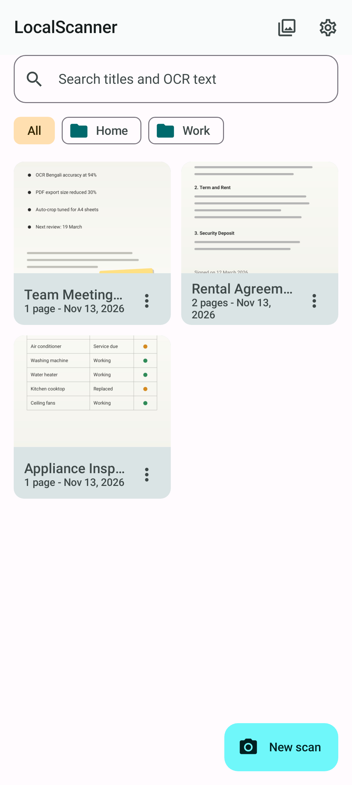
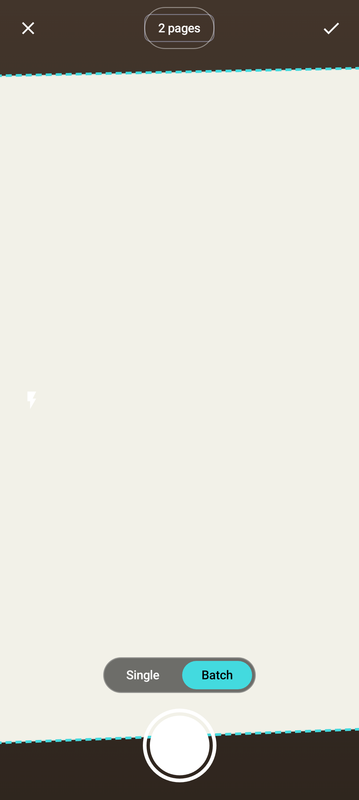
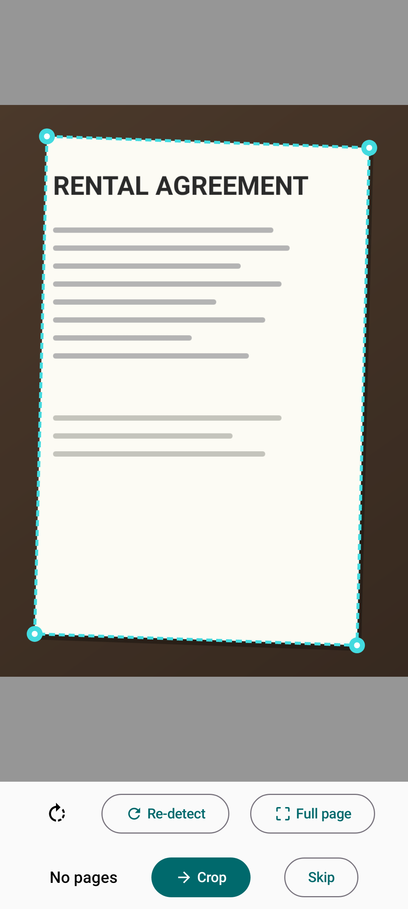
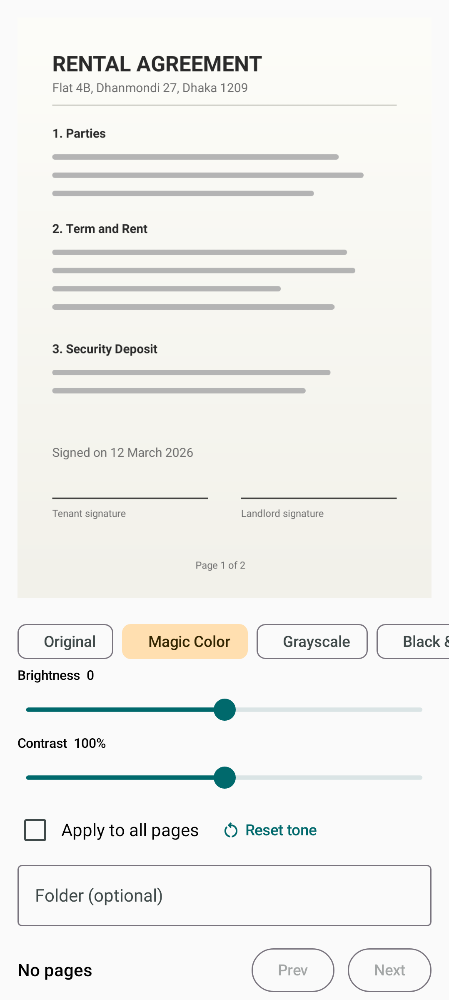
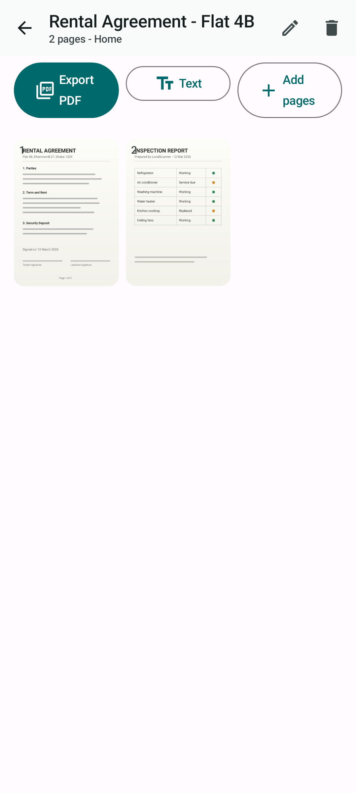
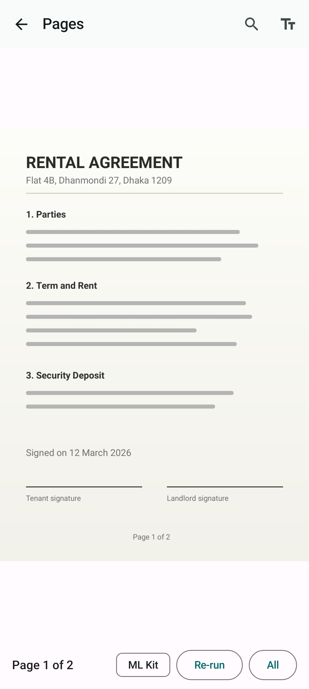
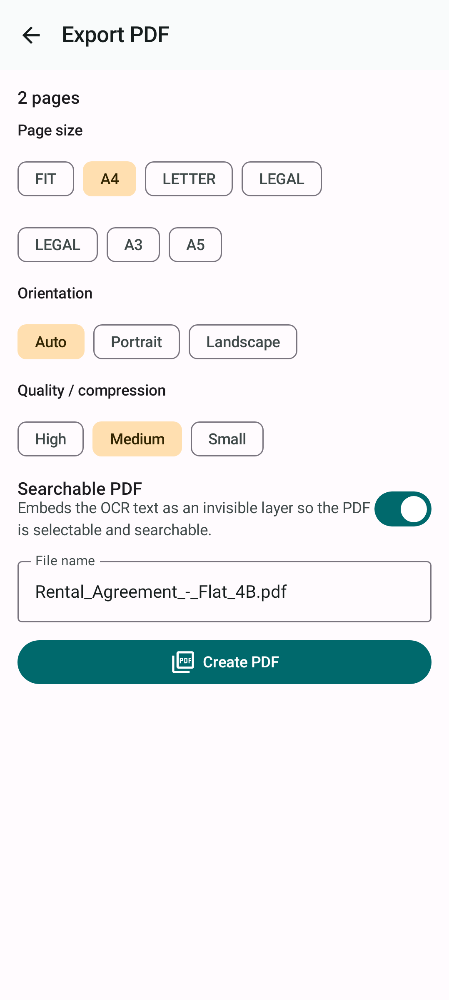
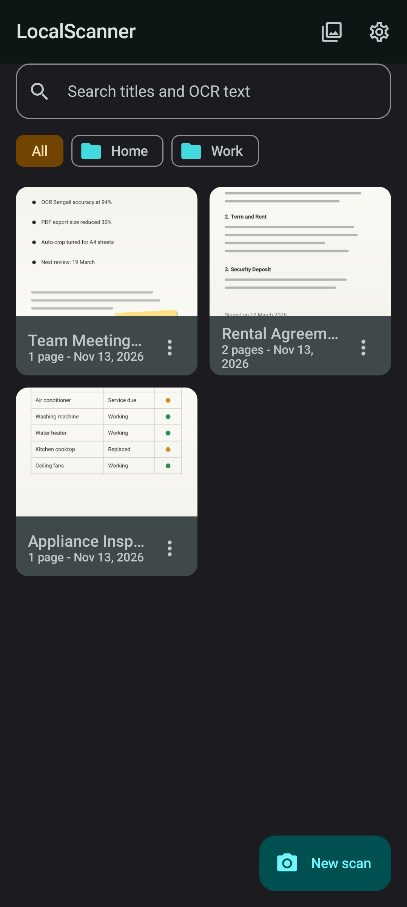
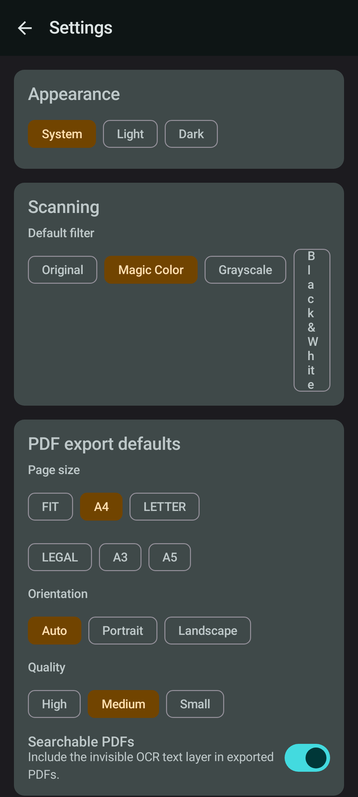

# LocalScanner

**A fully offline, open-source document scanner for Android that replicates the local (on-device) experience of CamScanner — without ads, without accounts, without watermarks, and without any data leaving your phone.**


## Download

Grab the latest APK from [GitHub Releases](https://github.com/touhidsiddiqueeraj-bit/LocalScanner/releases/latest):

```bash
# or with the GitHub CLI
gh release download --repo touhidsiddiqueeraj-bit/LocalScanner --pattern "*.apk"
```

Install, grant camera access, and scan. The APK bundles both OCR engines and all
models, so nothing is downloaded at runtime.

## Screenshots

| | | |
| --- | --- | --- |
|  |  |  |
| *Documents & search* | *Live edge detection* | *Manual corners* |
|  |  |  |
| *Magic Color enhance* | *Multi-page doc* | *Text on the page (selectable & searchable)* |
|  |  |  |
| *Searchable PDF export* | *Dark mode* | *Settings* |

Rendered by the [Screenshots workflow](https://github.com/touhidsiddiqueeraj-bit/LocalScanner/blob/main/.github/workflows/screenshots.yml):
Robolectric boots the real Compose screens with seeded data on a JVM runner and
Roborazzi writes the PNGs — no emulator, no device. The capture screen is a
reconstruction using the real edge-overlay component (runners have no camera).

## Features

| CamScanner capability | LocalScanner implementation |
| --- | --- |
| Auto edge detection while framing | OpenCV Canny + contour + `approxPolyDP` quad finder, live overlay on the CameraX preview |
| Single & batch shooting modes | CamScanner-style mode pills in the camera UI; Single auto-crops the page and jumps straight to enhancement, Batch keeps snapping pages for a combined review |
| Manual corner adjustment ("smart crop") | Draggable corner handles with dimmed background mask; auto-crop applies the detected quad automatically and an "Auto-crop all" action processes every remaining page |
| Perspective correction / de-skew | OpenCV `getPerspectiveTransform` + `warpPerspective` at up to 2048px |
| Magic Color / shadow removal | Illumination-normalization (background division) + CLAHE local contrast + saturation boost |
| Grayscale & Black & White modes | Adaptive-threshold B&W with auto block size, classic grayscale |
| Brightness / contrast tuning | Per-page sliders applied on top of any filter |
| Multi-page batch scanning | One session, N pages, append pages to existing documents |
| Gallery import | Android Photo Picker (multi-select, up to 20 images) |
| OCR (English) | ML Kit v2 bundled Latin model — fast, on-device |
| OCR (Bengali + English) | Tesseract 5 (`ben+eng`, tessdata_fast) bundled in the APK — on-device |
| Selectable OCR text on the page | No separate OCR screen: recognized lines are drawn on the page image, tap a line to select and copy it |
| Searchable OCR text | In-viewer search highlights matching lines on every page and jumps to them; full-text search covers titles and OCR text (Room + SQLite) |
| Searchable PDF export | PDFBox: page image + **invisible OCR text layer** (selectable/searchable, Bengali font embedded) |
| PDF page sizes | Fit-to-image, A4, Letter, Legal, A3, A5 + auto/portrait/landscape |
| PDF compression | High / Medium / Small quality presets |
| No watermark | CamScanner free tier stamps "Created by CamScanner" on exports — LocalScanner never does |
| Document management | Documents with cover thumbnails, folders, rename, delete, page reorder/rotate/delete |
| Print | Android print framework (PDF) |
| Dark mode | Material You theme with system/light/dark override |
| Cloud sync, fax, e-sign, AI extras | Intentionally **not** replicated — they are cloud services, not local scanning |

**Everything runs 100% on-device.** The app has zero network permissions, uses bundled ML models, and needs no Google Play Services.

## Tech stack

- **UI:** Kotlin + Jetpack Compose (Material 3)
- **Camera:** CameraX (preview + RGBA `ImageAnalysis` + `ImageCapture`)
- **Vision:** OpenCV 4.10 (`org.opencv:opencv` from Maven Central)
- **OCR:** ML Kit Text Recognition v2 (Latin, bundled) + Tesseract4Android 4.8 (ben+eng)
- **PDF:** Android `PdfDocument` (image PDFs) + PDFBox-Android (searchable text layer, embedded Noto Sans Bengali)
- **Storage:** Room database + app-private file storage, DataStore for settings
- **Min SDK:** Android 7.0 (API 24), target SDK 34

## Architecture

```
app/
├── data/            Room entities/DAOs, repository, DataStore settings, scan session
├── domain/          ScannerVision (OpenCV), OcrEngine (ML Kit), TessOcr, PdfExporter,
│                    PageSizeCalculator, Quad geometry (all unit-testable core logic)
├── ui/              Compose screens: home → capture (Single/Batch) → crop → filter → detail
│                    + page viewer (on-image OCR text), PDF export, settings
└── util/            Image I/O with EXIF, sharing/saving/printing
```

Scan flow (like CamScanner): **Capture → Auto-crop → Enhance → Save**. Text (OCR) and PDF
export are on-demand from the document screen.

## Building

```bash
./gradlew :app:assembleDebug     # debug APK
./gradlew :app:testDebugUnitTest --tests "com.localscanner.app.*Test"  # unit tests
./gradlew :app:recordRoborazziDebug --tests "com.localscanner.app.AppScreenshots"  # UI screenshots
./gradlew :app:assembleRelease   # release APK (signed with CI key if configured)
```

Requirements: JDK 17, Android SDK 34.

### Testing

- **Unit tests** (`QuadTest`, `TextUtilsTest`, `PageSizeCalculatorTest`): pure-JVM
  coverage of quad geometry, page-size math, text cleanup and the OCR line codec.
- **Screenshot tests** (`AppScreenshots`): render the real Compose screens with
  seeded Room/DataStore data on Robolectric and capture PNGs via Roborazzi.
  Images land in `app/src/test/screenshots/` locally and are committed to
  `docs/screenshots/` by the Screenshots workflow on every UI change.
- The DI container exposes overridable engine-init hooks
  (`LocalScannerApp.initEngines` / `onContainerReady`) so JVM tests run without
  the native OpenCV/Tesseract libraries.

## CI/CD

Three GitHub Actions workflows ship with the repository:

1. **`ci.yml`** — on every push/PR to `main`: builds the debug APK, runs unit tests, runs lint,
   uploads the APK as an artifact.
2. **`release.yml`** — on tag push `vX.Y.Z`: builds a **signed release APK** and attaches it to a
   GitHub Release with generated notes.
3. **`screenshots.yml`** — on UI changes: renders the real screens on a JVM runner
   (Robolectric + Roborazzi) and commits fresh PNGs to `docs/screenshots/`.

### Making signed releases work

Generate a keystore once:

```bash
keytool -genkey -v -keystore keystore.jks -keyalg RSA -keysize 2048 \
  -validity 10000 -alias localscanner
base64 -w0 keystore.jks   # copy the output
```

Then add these **repository secrets** (Settings → Secrets and variables → Actions):

| Secret | Value |
| --- | --- |
| `KEYSTORE_BASE64` | base64 of the keystore |
| `KEYSTORE_PASSWORD` | keystore password |
| `KEY_ALIAS` | `localscanner` |
| `KEY_PASSWORD` | key password |

Without secrets the workflow still runs — the APK falls back to the debug signing key.
Never commit `keystore.jks` to the repository (it is git-ignored).

To cut a release:

```bash
git tag vX.Y.Z && git push origin vX.Y.Z
```

The workflow builds the APK, renames it to `LocalScanner-<version>.apk` and
publishes a GitHub Release with generated notes. Update `CHANGELOG.md` for each
release.

## Release history

- **1.0.0** (2026-11-13) — first full release. See [CHANGELOG.md](CHANGELOG.md).

## Roadmap

- Dewarping of curved pages (curve correction)
- OCR: more Tesseract languages (Hindi, Arabic, ...) via downloadable traineddata
- ID-card mode (front/back on one page)
- Encrypted PDF export
- Per-document password lock

## License

Apache License 2.0. Third-party components: OpenCV (Apache 2.0), Tesseract (Apache 2.0),
tessdata_fast (Apache 2.0), PDFBox-Android (Apache 2.0), ML Kit (binding under Apache 2.0,
see Google's terms), Noto Sans Bengali (OFL).
